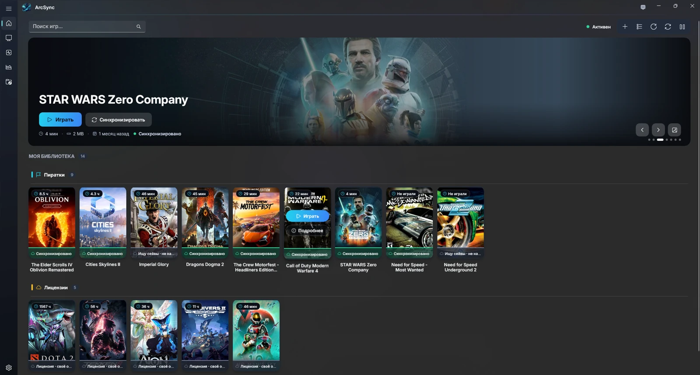
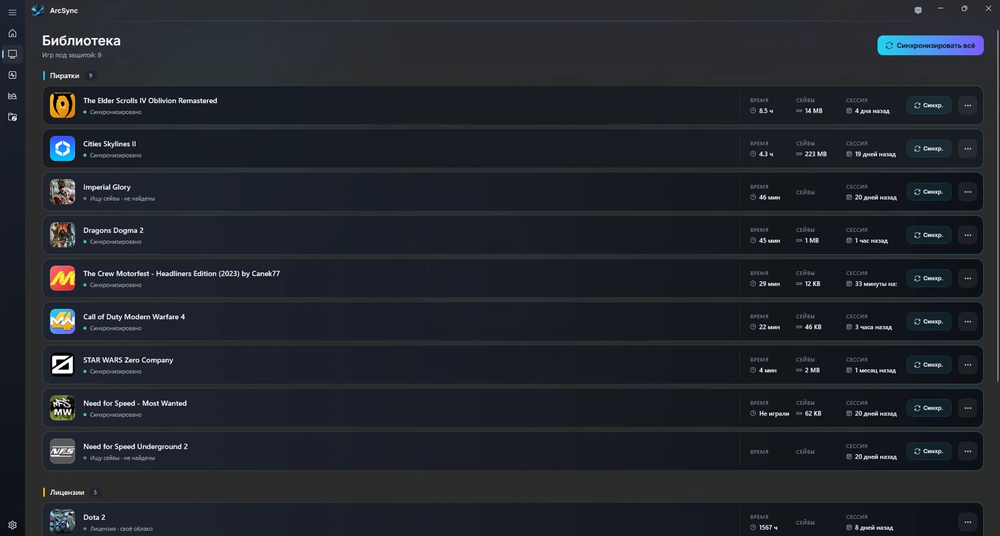
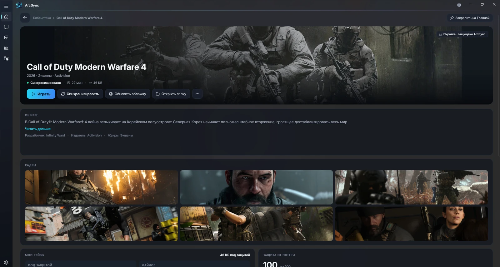
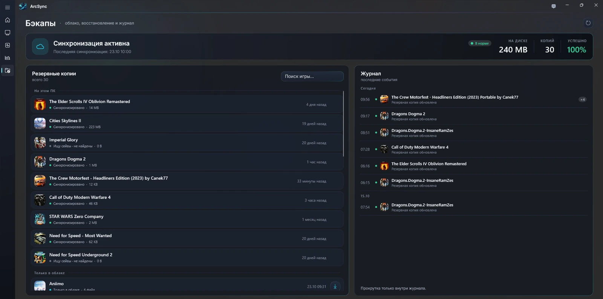
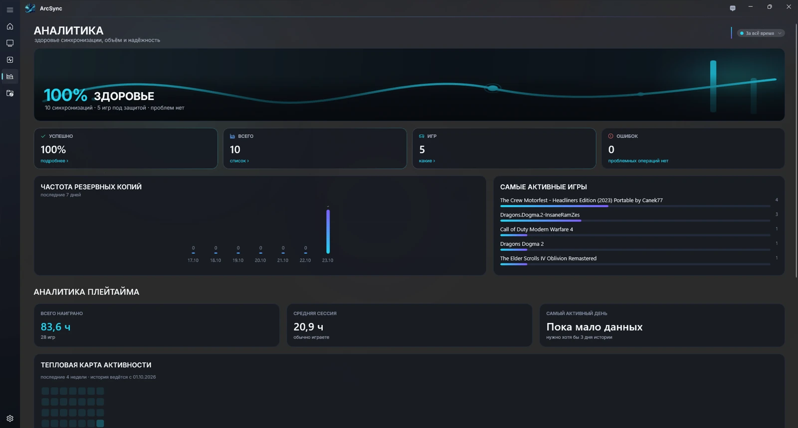

# ArcSync

**Your games. Your progress. Your cloud.**

[Download for Windows](https://github.com/Rezerv-EM/ArcSync/releases/latest) · [Website](https://rezerv-em.github.io/ArcSync/) · [Release history](CHANGELOG.md) · [Русский](README.ru.md)

A free Windows game launcher and save-game sync tool. One library for quick launch, backups and playtime. Your saves go to **your own cloud folder**, not ArcSync servers.

**Windows 10 / 11 · x64 · Russian & English · No ArcSync subscription · No telemetry**



## What's new in 0.1.5

- New: stream games to an Android phone, Android TV or PSP and launch them from your library. Streaming servers start only when a device connects and shut down completely afterwards.
- Games started through a launcher in a sub-folder are tracked again: play sessions, playtime and sync after playing.
- Single-player games are no longer labeled as online games; saves inside the game folder, in Downloads and in folders named with the series abbreviation ("NFS ...") are found.
- Games start as the signed-in user instead of with administrator rights; new startup screen; the tray icon is back.

[Full release notes and downloads →](https://github.com/Rezerv-EM/ArcSync/releases/tag/v0.1.5)

## Features

- Launch installed games from one library and track playtime.
- Discover saves and back them up to your chosen cloud folder.
- Restore progress after reinstalling Windows or moving to another PC.
- Stream games to an Android phone, Android TV or PSP (servers run only on demand).
- Keep backup history and a synchronization log.
- Work in the system tray, with event-based and scheduled sync.

Use OneDrive, Google Drive, Dropbox, Yandex Disk, MEGA, Nextcloud, or another folder managed by your installed cloud client. Games with their own store cloud are shown separately to avoid duplicate synchronization.

## Streaming add-ons (alpha)

Play the games of your ArcSync library on other screens. The streaming servers come with ArcSync 0.1.5+ and run only on demand.

| Add-on | What it does |
|---|---|
| [ArcSync Cast for Android](https://github.com/Rezerv-EM/ArcSync-AndroidCast) | Your library and PC game streaming on the phone |
| [ArcSync Cast TV](https://github.com/Rezerv-EM/ArcSync-AndroidCastTV) | The same on Android TV, made for the remote |
| [ArcSync for PSP](https://github.com/Rezerv-EM/ArcSync-PSPCast) | Your library and PC game streaming on a PlayStation Portable |

## Interface

### Library



### Game details



### Backups



### Analytics



Screenshots show the Russian interface with example data. English is available in Settings.

## Install or update

1. Download **`ArcSync_Setup_<version>.exe`** from the [latest release](https://github.com/Rezerv-EM/ArcSync/releases/latest).
2. Compare its SHA-256 with `SHA256SUMS.txt` attached to the **same release**.
3. Run the installer. To update, use the existing install directory; uninstalling first is not required.
4. Select your cloud folder on first run. Change language in **Settings → General**.

.NET and Windows App SDK are bundled. Requires Windows 10 build 19041+ or Windows 11, x64, administrator rights and approximately 160 MB of disk space.

### Verify your download

```text
certutil -hashfile ArcSync_Setup_<version>.exe SHA256
```

The installer is not code-signed. SmartScreen may warn about an unknown publisher. This warning is not proof of safety: use official release files and verify their checksum.

## Privacy and data

- No telemetry, advertising or mandatory ArcSync account.
- Saves go only to your selected cloud folder.
- Local settings, logs and cache live in `%LOCALAPPDATA%\ArcSync` for a normal installation.
- ArcSync does not automatically clean your cloud folder or delete other files there.
- Removing a game does not remove saved backups.
- Artwork and descriptions are fetched from external sources using the game title.

## Feedback and licensing

Report bugs in [Issues](https://github.com/Rezerv-EM/ArcSync/issues). Include the app version, Windows version and steps to reproduce. Remove personal paths and private information from logs before posting.

ArcSync is free to use. Application source code remains private; this repository contains releases, documentation and the website. See [EULA](EULA.txt) and [third-party notices](THIRD_PARTY_NOTICES.md). Game names and images belong to their respective owners.
