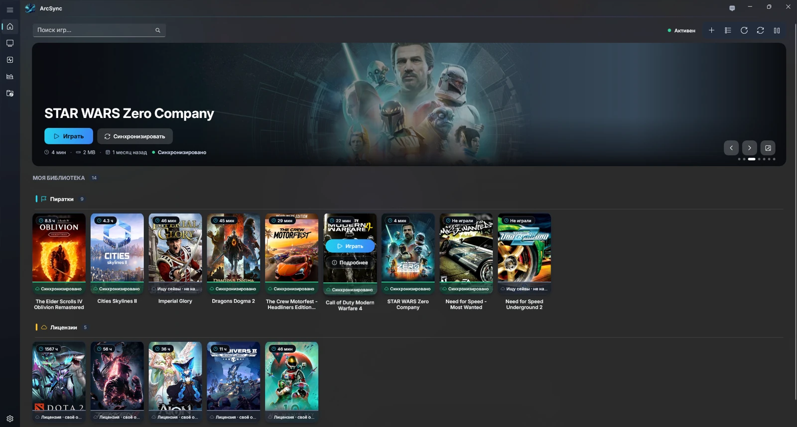
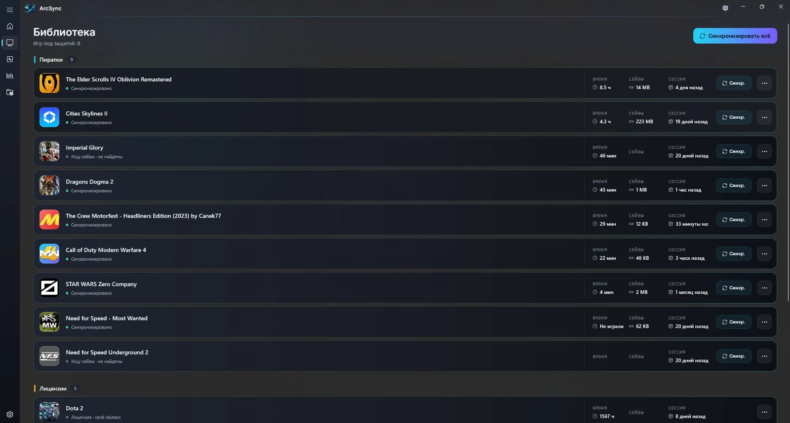
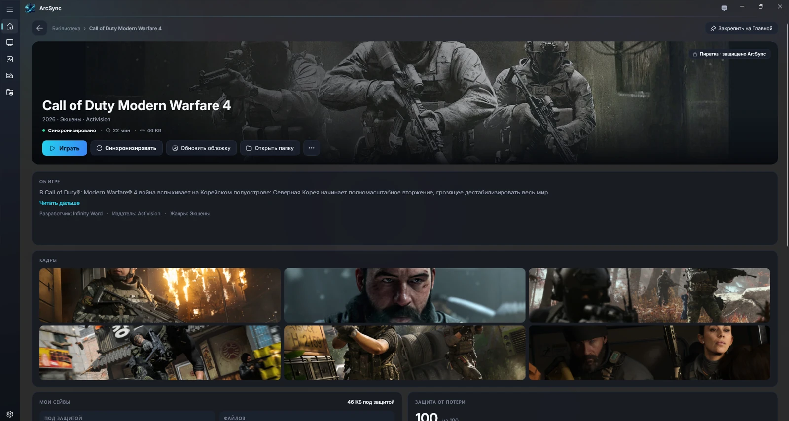
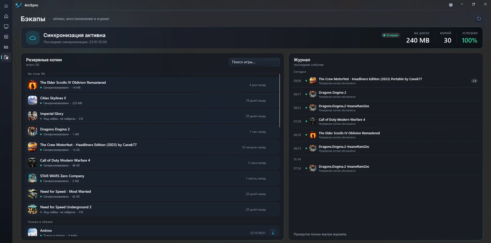
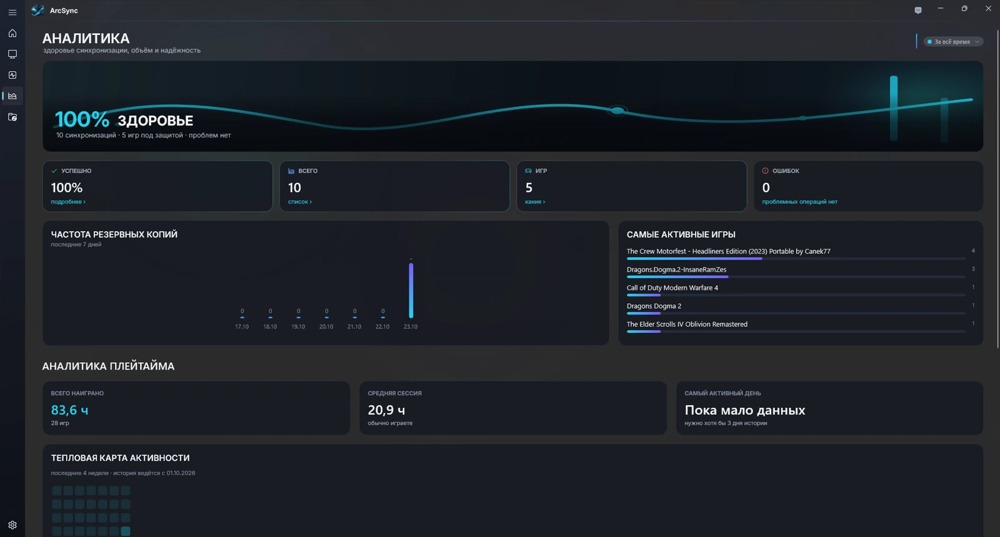

# ArcSync

**Все игры рядом. Прогресс — с тобой.**

[Скачать для Windows](https://github.com/Rezerv-EM/ArcSync/releases/latest) · [Сайт](https://rezerv-em.github.io/ArcSync/) · [История версий](CHANGELOG.md) · [English](README.md)

Бесплатный лаунчер игр и синхронизатор сохранений для Windows. Библиотека, быстрый запуск, резервные копии и плейтайм — в одном приложении. Сейвы хранятся в **твоей облачной папке**, а не на серверах ArcSync.

**Windows 10 / 11 · x64 · Русский и English · Без подписки ArcSync · Без телеметрии**



## Новое в 0.1.3

- Меньше лишнего в библиотеке: папки-обёртки, программы и остатки записей реестра больше не превращаются в игры.
- Надёжнее сейвы и восстановление: папка установки и данные других программ не принимаются за сохранения, у игры одна облачная папка, восстановление берёт только текущие сейвы.
- Обложка, баннер, логотип и описание всегда от одной и той же игры; полноразмерные баннеры от сообщества для игр без арта в магазинах.
- Игры запускаются через лаунчер, который ими управляет; сбор диагностики в настройках.

[Полное описание и файлы обновления →](https://github.com/Rezerv-EM/ArcSync/releases/tag/v0.1.3)

## Возможности

- Запуск установленных игр и учёт наигранного времени.
- Автоматический поиск сохранений и копирование в выбранную облачную папку.
- Восстановление прогресса после переустановки Windows или на другом ПК.
- Резервные копии и журнал синхронизаций.
- Работа в трее, синхронизация по событиям и расписанию.

Подойдёт OneDrive, Google Drive, Яндекс Диск, Dropbox, MEGA, Nextcloud или другая папка, которую синхронизирует установленный облачный клиент. Игры с собственным облаком магазина показываются отдельно — без дублирования синхронизации.

## Интерфейс

### Библиотека



### Карточка игры



### Резервные копии



### Аналитика



На скриншотах — русский интерфейс с примером данных. Английский доступен в настройках.

## Установка и обновление

1. Скачай **`ArcSync_Setup_<версия>.exe`** из [последнего релиза](https://github.com/Rezerv-EM/ArcSync/releases/latest).
2. Сверь SHA-256 с `SHA256SUMS.txt`, приложенным **к этому же релизу**.
3. Запусти установщик. При обновлении выбери существующую папку установки; предварительно удалять приложение не нужно.
4. При первом запуске выбери облачную папку. Язык — **Настройки → Общие**.

.NET и Windows App SDK уже включены. Нужны Windows 10 от сборки 19041 или Windows 11, x64, права администратора и около 160 МБ места.

### Проверка файла

```text
certutil -hashfile ArcSync_Setup_<версия>.exe SHA256
```

Установщик не подписан цифровым сертификатом. SmartScreen может показать «Неизвестный издатель». Предупреждение не доказывает безопасность: используй официальный релиз и проверяй контрольную сумму.

## Приватность и данные

- Нет телеметрии, рекламы и обязательного аккаунта ArcSync.
- Сейвы отправляются только в выбранную облачную папку.
- При обычной установке настройки, журналы и кэш находятся в `%LOCALAPPDATA%\ArcSync`.
- Программа не чистит облако автоматически и не удаляет чужие файлы.
- После удаления игры резервные копии сохраняются.
- За обложками и описаниями программа обращается к внешним источникам, передавая название игры.

## Обратная связь и лицензия

Об ошибках пиши в [Issues](https://github.com/Rezerv-EM/ArcSync/issues): версия ArcSync, версия Windows, шаги воспроизведения. Убери личные пути и приватные сведения из журналов перед публикацией.

ArcSync бесплатен. Исходники приложения приватные; здесь — релизы, документация и сайт. Условия — [EULA](EULA.txt), компоненты — [THIRD_PARTY_NOTICES](THIRD_PARTY_NOTICES.md). Названия и изображения игр принадлежат правообладателям.
